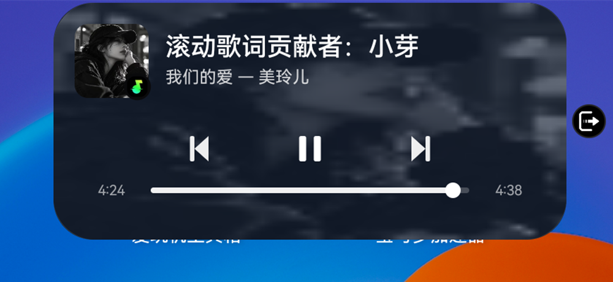

# LiveIsland · 鸿蒙灵动岛

在 HarmonyOS 状态栏上画一颗「灵动岛」的 LSPosed 模块。

点开变成卡片，音乐、导航、外卖、秒表、USB 等。




---

## 功能

| 模块       | 说明                                           |
| -------- | -------------------------------------------- |
| **音乐**   | 任意 MediaSession 都能上岛，展开后是进度条 + 上一首/播放/下一首    |
| **导航**   | 百度地图：转向箭头、剩余距离、路名，展开显示完整导航信息                 |
| **实况通知** | 按华为实况窗协议发通知的 App（外卖、打车、录音…）自动上岛，支持操作按钮       |
| **秒表**   | 华为时钟的秒表不发通知，模块从时钟进程取时间，上岛后可直接暂停/重置           |
| **USB**  | 插数据线自动上岛，可直接切换「文件传输 / 传输照片 / 仅充电」            |
| **HUD**  | 插电显示充电环、低电量弹电池图标、调音量/铃声模式显示图标与数值，3–5 秒自动消失   |
| **多活动**  | 药丸、右侧圆点、展开卡片各占一个槽位，第 4 个起进隐藏队列，反复点击即可轮换，不限数量 |
| **设置**   | 独立设置界面：背景样式、8 个功能开关、一键重启作用域，改动即时生效           |

## 背景样式

设置里可选两种：

- **毛玻璃** —— 实时截屏模糊后透出身后界面的颜色
- **纯黑** —— 不透明黑底

字体颜色按背景亮度自动反色（亮底深字 / 暗底白字）。

## 工作原理

```
IslandHook ──► IslandController ──► IslandView（全部 Canvas 自绘）
   │                  │
   │                  ├─ MediaSession         音乐
   │                  ├─ 广播 + 进程内 hook    导航 / 秒表
   │                  ├─ NotificationListener  实况通知
   │                  └─ SurfaceControl 截图 → 降采样 → 盒式模糊（背景）
   │
   └─ 注入 SystemUI / 地图 / 时钟 / 设置
```

几个关键点：

- **不申请悬浮窗权限**：直接 `WindowManager.addView` 到 SystemUI，用 `TYPE_SYSTEM_ERROR` 层级。
- **绘制窗口永不接收触摸**：大面积透明窗口在华为 ROM 上即使标了 `NOT_TOUCHABLE` 也会吃掉点击，  
  所以触摸全部交给两个独立小窗（收起态药丸大小、展开态卡片大小），按 1:1 转发坐标。
- **窗口宽度恒定、只改高度**：避免缩放窗口时药丸横向跳动，也避免残留的透明区域遮挡下方点击。
- **背景模糊**：`screenshot_ext_hw` 取半尺寸截图 → 转成内存位图（hardware bitmap 不能直接读像素）  
  → 降采样到 1/16 → 三遍盒式模糊（近似高斯）→ 叠遮罩。全程在后台线程完成，主线程只做引用交换。
- **跨进程配置**：设置页写自己的 SharedPreferences，SystemUI 通过同 APK 的 `ContentProvider` 读取，  
  改完发广播即时生效，不需要重启。

## 构建

需要 JDK 17 与 Android SDK（compileSdk 34）。

```bash
# 1. 配置 SDK 路径
echo "sdk.dir=/path/to/Android/Sdk" > local.properties

# 2. 配置签名（可选，不配则用 debug 签名）
cat > keystore.properties <<EOF
storeFile=/path/to/your.jks
storePassword=******
keyAlias=your_alias
keyPassword=******
EOF

# 3. 构建
./gradlew :app:assembleRelease
```

产物：`LiveIsland.apk`（项目根目录），同时保留一份在 `app/build/outputs/apk/release/`。

`app/libs/xposed-stub.jar` 是 Xposed API 的**编译期桩**，只提供方法签名，不会打包进 APK。  
如果你想改用官方依赖，把 `app/build.gradle` 里的 `compileOnly files(...)` 换成：

```gradle
compileOnly 'de.robv.android.xposed:api:82'
```

## 安装

1. 安装 APK；
2. 在 **LSPosed** 中启用本模块；
3. 作用域勾选：**系统界面**（必须）、百度地图 / 时钟 / 设置（可选，对应功能才需要）；
4. 重启 SystemUI（设置页有「重启 SystemUI」按钮，需要 Root）。

## 已知限制

- **系统级实时模糊不可用**：本模块的自定义窗口无法调用 SurfaceFlinger 的背景模糊  
  （`ro.surface_flinger.supports_background_blur` 在鸿蒙上未启用），因此背景靠截屏 + 模糊实现，  
  切换界面时约有 200ms 的跟进延迟。

## 许可证

本项目以GPL-3.0或更高版本协议开源，完整条款见 [LICENSE](LICENSE)
